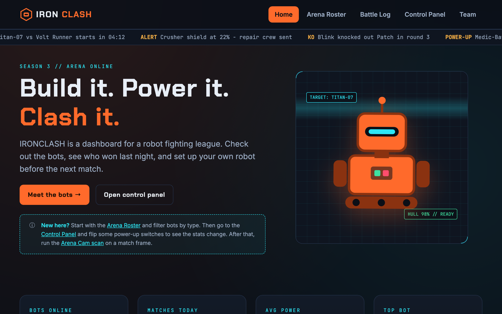
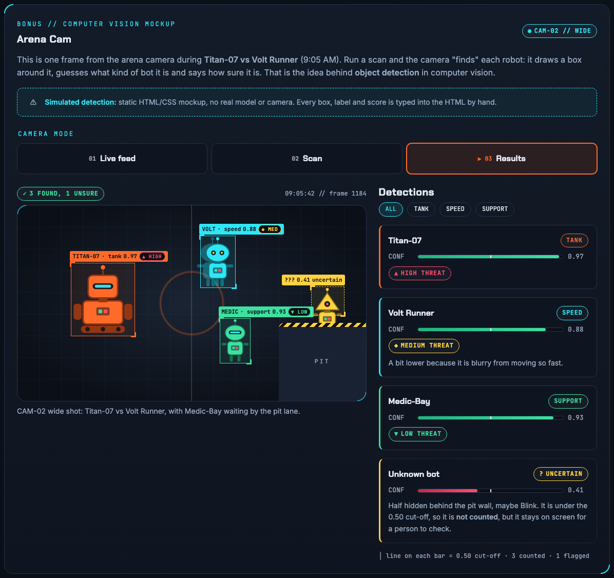
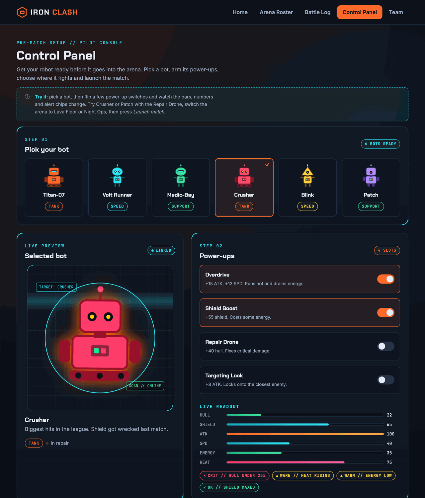
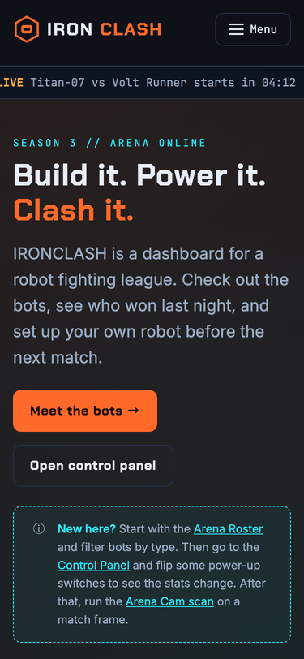
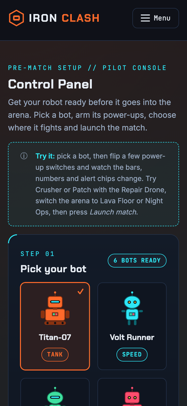

# IRONCLASH - robot arena dashboard

CSC 4370 Project 1 (HTML/CSS) - Rajan Sharma

IRONCLASH is a dashboard for a made up robot fighting league. You can check out the bots, look at last night's matches, run a fake arena camera scan, and set up your own robot before a match. It's all HTML and CSS, no javascript. Everything that changes on the page is done with css states like `:checked`, `:has()` and `:target`.

- topic track: Track E, Robot Arena Dashboard
- extension pack: Combat HUD (status bars, alert chips, overlays)
- bonus feature: computer vision overlay, which I called "Arena Cam" (on the battle log page)
- live site: https://codd.cs.gsu.edu/~rsharma30/Sharma_RobotArena/



## pages

- **home** (`index.html`): hero with the floating robot, live alert ticker, arena stats, featured matchup
- **arena roster** (`roster.html`): all 6 bots with hull/attack/speed bars, plus a filter by type (tank / speed / support)
- **battle log** (`battle-log.html`): match timeline, results table, replay popups, and the arena cam
- **control panel** (`control-panel.html`): pick a bot, turn on power-ups and watch the stats change, pick an arena, launch a match with a 3-2-1 countdown, equip an AI pilot
- **team** (`team.html`): team intro, roles, time tracking

## how to run it

Nothing to install. Just open `index.html` in a browser, or run `python3 -m http.server` in the folder and go to `localhost:8000`.

To put it on CODD, copy the whole folder into `public_html`.

## folder structure

```
Sharma_RobotArena/
  index.html, roster.html, battle-log.html, control-panel.html, team.html
  css/
    style.css        variables, layout, components, page styles, media queries
    animations.css   all the @keyframes
    arena-cam.css    the bonus feature (only loaded on the battle log)
  images/            logo + robot svgs
  docs/              proposal, wireframes, kanban, journal, qa notes, bonus notes, screenshots
```

Every page loads `style.css` first and then `animations.css`. The battle log also loads `arena-cam.css`. The header, nav and footer are the same on every page, and `aria-current="page"` marks which page you're on, which is also what highlights the nav link.

## design decisions

- I set up all the colors, fonts, spacing and timing as css variables in `:root` first, so the 5 pages can't drift apart. The cards, buttons, chips, stat bars and hud corners are reused everywhere.
- Dark arena look. Orange is for actions and warnings, cyan is for hud lines and data. Status always has a word or icon too, not just a color (Online / Repair / Offline, OK / WARN / CRIT).
- Fonts: Chakra Petch for headings, Inter for text, JetBrains Mono for numbers.
- Grid for page sections and card grids, flexbox for rows (header, chips, filter bar, switches). It's mobile first, with breakpoints at 640px and 960px.
- The control panel is the part I'm happiest with. Each power-up switch just sets a 0/1 variable with `:has()`, and each stat bar works out `base + bonus` with `calc()`, clamped between 0 and 100. One formula per bar means any mix of power-ups works without extra rules.
- Replays and the launch countdown open with `:target`. The roster filter uses radio buttons and the `~` selector.
- Every animation is there to show something: the status pulse means the bot is online, the bars grow in, the ticker is live alerts, the rows flash when a power-up kicks in, the countdown builds up the match, and the scan beam shows the camera working.
- If someone has reduced motion turned on, animations finish instantly and the delays are removed.

trade-off: `:has()` made the control panel way simpler than doing it all with sibling selectors, but it needs a newer browser (chrome/edge 105+, safari 15.4+, firefox 121+). Older browsers still show everything, the bars just don't react.

## accessibility

- header / nav / main / section / footer on every page, one h1 per page, headings in order
- skip link and visible focus outlines on everything you can tab to. The hidden radio and checkbox inputs are still focusable, and the outline shows on their label
- every input has a label, every image has alt text (decorative ones use empty alt)
- the control panel alerts are in an `aria-live` area, and the duplicate ticker items are `aria-hidden` so they don't get read twice
- tables that scroll on phones can be focused, so you can scroll them with the keyboard
- reduced motion is respected everywhere

## bonus: arena cam

The arena cam is on the battle log page. It pretends to be the arena camera running object detection on one frame from a match. There are three modes: live feed, scan and results.

- **scan:** a beam sweeps the frame.
- **results:** a box locks onto each robot, with a label, a confidence score and a threat level. There's also a list next to the frame with the same info as text.

One robot is half hidden behind the pit wall, so it gets a dashed box and a low score (0.41) marked "uncertain" instead of a name. That was my main design idea for it: real detection isn't always sure, so the UI should show the "maybe" differently. The page also says it's a simulation, since there's no real model or camera behind it.

- AI concept: object detection (bounding boxes, class labels, confidence scores, a cut-off for low scores)
- built with: radio buttons + `:has()` for the three modes, percentage positions so the boxes stay on the bots at any screen size, staggered `animation-delay` so the boxes lock on one by one
- trade-offs: without js it can't move from scan to results by itself, so the results button pulses when the scan is done. The scores are fixed since it's a mockup

More detail and the test checks are in [docs/bonus-arena-cam.md](docs/bonus-arena-cam.md).



## process

- kanban board: [docs/kanban.md](docs/kanban.md) (the git history of this file shows the cards moving)
- dev journal: [docs/dev-journal.md](docs/dev-journal.md)
- qa notes: [docs/qa-notes.md](docs/qa-notes.md)
- proposal + wireframes: [docs/Sharma_RobotArena_Proposal.docx](docs/Sharma_RobotArena_Proposal.docx)

## screenshots



 

## what I'd change next

- the AI pilot flip cards work on hover and focus, so a tap to flip version would be better on phones
- a light theme would only need new values in `:root`, since nothing else hard codes colors

## notes

I used AI tools while building this, for the code, the docs and the video voice-over. I went through and tested all of it and can explain any part of it.

Fonts are from Google Fonts (Chakra Petch, Inter, JetBrains Mono, all under the SIL Open Font License). The robot svgs and logo were made for this project.
